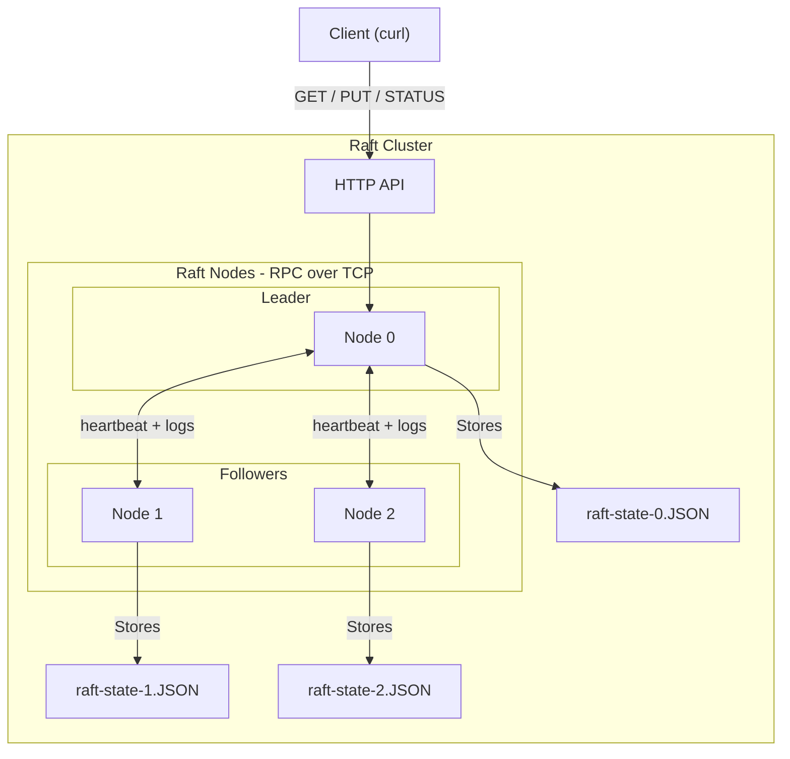

# raft-kv
Created by Diego Ongaro and John Ousterhout, the [Raft Consensus Algorithm](https://web.stanford.edu/~ouster/cgi-bin/papers/raft-atc14) is a leader-based consensus algorithm that manages replicated logs across servers in a distributed system. In Go, I built a key-value store using the Raft consensus algorithm by creating three nodes that elect a leader, replicate client logs  over TCP, and keep serving when a node dies. All logs are written to disk, ensuring that restarts will not erase committed data.

**Author: @J-Hwang7**

# How it works
**Leader Election** 

Through randomized election timeouts, follower nodes can verify that the leader mode is functional, as the leader sends heartbeats to reset the election timeouts of the follower nodes. If a follower does not receive heartbeats within the election timeout, it becomes a candidate and initiates a new election. Based on a majority vote principle, the candidate with the most votes becomes a leader node. Each server tracks the term number.

**Log Replication**

The leader node appends client values to a replicated log and pushes them to follower nodes with `AppendEntries`, ensuring that the leader node and follower nodes have matching logs. By checking the `PrevLogTerm` and `PrevLogIndex`, conflicts are avoided in the logs.

**Crash-safe Persistence** 

`log`, `votedFor`, and `currentTerm` are committed to the disk, as each node state is written into a raft-state-#.JSON file. This procedure occurs before any RPC. Since node states are preserved, they can be restarted and recovered without a loss of node data.

# Simulating Election
**Requires Go 1.21+ to run.** In 3 individual terminals, run one of the commands.
```
go run . -id 0 -http localhost:9000
go run . -id 1 -http localhost:9001
go run . -id 2 -http localhost:9002
```

After a node wins the election, open a fourth terminal and run the following commands to set a value.
```
curl "http://localhost:9000/put?key=x&value=5"
curl "http://localhost:9000/get?key=x"
curl "http://localhost:9000/status"
```
The value 5 is stored within the key "x", as `/status` retrieves information about a node's term, role, commit index, and key-value history.

## Leader Failure
Create 3 nodes and run the following commands to write a client value and kill the leader node. The election process will automatically commence and serve logs over a new leader.
```
curl "http://localhost:9000/put?key=city&value=atlanta"
//In leader terminal, (Ctrl + C) to kill the leader
curl "http://localhost:9001/get?key=city"
```

## Full-Cluster Restart
Within each running node, use **Ctrl + C** to kill each node. Since the term, vote, and log have been written to a `raft-state-#.JSON` file, log replication resumes with the same state from before killing the node.

## Diagram of raft-kv


# Project Architecture 
```
raft-kv/
main.go          flags all nodes, acts as an entry point, defines node ID
Raft/
client.go        submits requests
election.go      heartbeat loop, elections, commit advance
httpapi.go       HTTP API
raft.go          logs, applies heartbeat loop, node state
rpc.go           RequestVote & AppendEntries
storage.go       fault tolerance 
```

# References
Ongaro, Diego, and John Ousterhout. _In Search of an Understandable Consensus Algorithm_ 19 July 2014.

“Raft.” _Thesecretlivesofdata.Com_, 2026, https://thesecretlivesofdata.com/raft/. 

“Raft Consensus Algorithm.” _Raft.Github.Io_, https://raft.github.io/.
